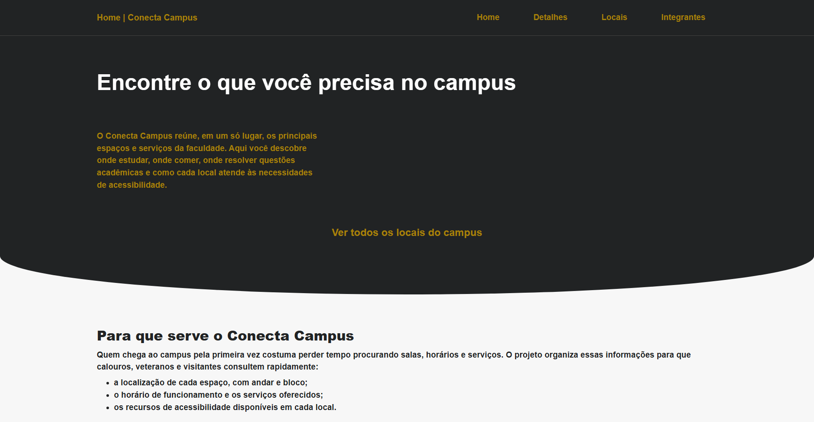
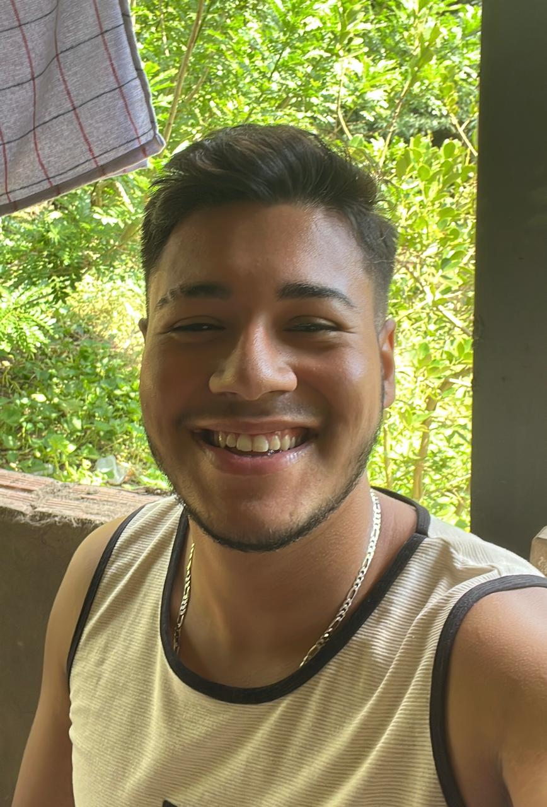
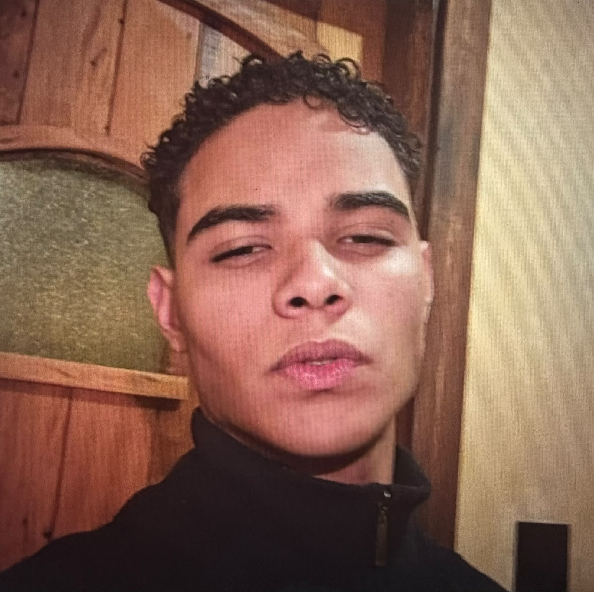

# 🏫 Conecta Campus

Site institucional que reúne, em um só lugar, os principais espaços e serviços de um campus universitário: onde estudar, onde comer, onde resolver questões acadêmicas e quais recursos de acessibilidade cada local oferece.

Projeto acadêmico do **Checkpoint 2 (CP2)** da disciplina **Front-End Design Engineering**, FIAP | 2026 | turma 1TDSPB.

## 🌐 Acesse o projeto

👉 **[Ver o site no ar](https://kauanzxd.github.io/Front-End_Checkpoint_2/)**

## 📸 Preview



## 🎯 Objetivo

Quem chega ao campus pela primeira vez costuma perder tempo procurando salas, horários e serviços. O Conecta Campus organiza essas informações para que calouros, veteranos e visitantes consultem rapidamente:

- a localização de cada espaço, com andar e bloco;
- o horário de funcionamento e os serviços oferecidos;
- os recursos de acessibilidade disponíveis em cada local.

## 📄 Páginas

| Página | Arquivo | O que mostra |
| --- | --- | --- |
| **Home** | `index.html` | Apresentação do projeto, finalidade e 3 locais em destaque (Biblioteca, Laboratório e Restaurante). |
| **Detalhes** | `detalhes.html` | Ficha completa de 6 locais: categoria, localização, horário, serviços oferecidos e recursos de acessibilidade, com atalhos de navegação no topo. |
| **Locais** | `locais.html` | Carrossel com 6 locais do campus, cada um com foto, descrição, localização e uma informação útil. |
| **Integrantes** | `integrantes.html` | Cartões com foto, RM, turma e links (GitHub e LinkedIn) de cada integrante do grupo. |

Os locais cobertos são: Biblioteca Central, Laboratório de Informática, Restaurante Universitário, Secretaria Acadêmica, Auditório Principal e Área de Lazer.

## ✨ Destaques técnicos

- **HTML semântico**: uso de `header`, `nav`, `main`, `section`, `article` e `footer`, além de listas de descrição (`dl`, `dt`, `dd`) nas fichas dos locais.
- **Acessibilidade**: atributos `aria-label` e `aria-labelledby`, `aria-current="page"` no menu, textos alternativos descritivos nas imagens e idioma da página definido como `pt-BR`.
- **CSS organizado com variáveis** (`:root`): paleta de cores, raio de borda e escala de espaçamentos reutilizados em todo o site.
- **Layout com Flexbox e Grid**: cabeçalho, rodapé, cartões e galerias.
- **Carrossel feito só com CSS**: usa `scroll-snap` e âncoras (`#slide1`, `#slide2`...), sem JavaScript.
- **Design responsivo**: ajustes de layout com `@media` para telas de até 900px e 600px.
- **Navegação interna**: os cartões da Home levam direto ao local correspondente na página de Detalhes por meio de âncoras (ex.: `detalhes.html#biblioteca`).

## 🛠️ Tecnologias

[](https://github.com/search?q=user%3AKauanzxd+topic%3Apython&type=repositories)
[](https://github.com/search?q=user%3AKauanzxd+topic%3Acss&type=repositories)

## 📂 Estrutura do projeto

```
Front-End_Checkpoint_2/
├── css/
│   └── style.css            # Estilos de todas as páginas
├── img/
│   ├── img_*_campus.png     # Fotos dos 6 locais do campus
│   └── *.jpeg               # Fotos dos integrantes
├── index.html               # Página inicial
├── detalhes.html            # Detalhes dos locais
├── locais.html              # Carrossel de locais
├── integrantes.html         # Integrantes do grupo
└── README.md
```

## ▶️ Como executar

O projeto é estático, não precisa de instalação nem de servidor.

1. Clone o repositório:
   ```bash
   git clone https://github.com/Kauanzxd/Front-End_Checkpoint_2.git
   ```
2. Entre na pasta do projeto:
   ```bash
   cd Front-End_Checkpoint_2
   ```
3. Abra o arquivo `index.html` no navegador (duplo clique ou, no VS Code, com a extensão *Live Server*).

## 👥 Integrantes

| Foto | Nome | RM | GitHub | LinkedIn |
| --- | --- | --- | --- | --- |
|  | Kauan Gomes dos Santos | 574837 | [Kauanzxd](https://github.com/Kauanzxd) | [LinkedIn](https://www.linkedin.com/in/kauan-gomes-dos-santos-94b02a430/) |
|  | Pablo Ackillys Anjos da Silva | 576881 | [PabloAckillys](https://github.com/PabloAckillys) | [LinkedIn](https://www.linkedin.com/in/pabloackillys) |
|  | Thomaz Rafael Krutman Neves da Rocha | 576834 | [ThomazRocha](https://github.com/ThomazRocha) | [LinkedIn](https://www.linkedin.com/in/thomaz-rafael-krutman-neves-da-rocha-42aa7343a/) |
|  | Eduardo Regenold da Costa Lima | 574720 | [edurege-14](https://github.com/edurege-14) | [LinkedIn](https://www.linkedin.com/in/eduardo-regenold-b09bab397/) |

## 📚 Contexto acadêmico

- **Instituição:** FIAP
- **Disciplina:** Front-End Design Engineering
- **Turma:** 1TDSPB
- **Ano:** 2026
- **Finalidade:** avaliação do Checkpoint 2 (CP2)
